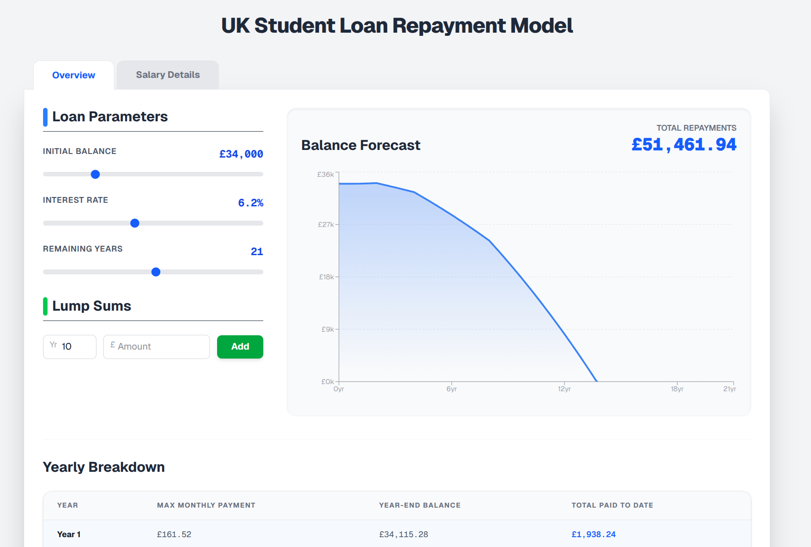

# UK Student Loan Repayment Calculator

A scenario-modeling web application built to bring clarity and transparency to UK student loan repayments over time. Developed with **Next.js** using **AGY CLI** as an AI development agent, this project serves both as a practical personal finance tool and a demonstration of **AI Product Management**—translating user problems, financial modeling logic, and iterative product workflows into working software.

Below is a quick and dirty demo video made with Trupeer. Not bad for a one-pass!

---

## Demo & Media




Watch the full walkthrough on [Trupeer](https://app.trupeer.ai/view/EnITmp5Jb/uk-student-loan-repayment-calculator) or download the [MP4 demo](media/demo.mp4) (the lagginess is due to my slow chromebook, not an issue with trupeer).

---

## Product Vision & AI PM Perspective

Many UK borrowers take on significant student loan balances without a clear view of how interest rates, wage growth, write-off windows, or lump-sum overpayments interact over decades. This tool focuses on **what-if scenario exploration** rather than static one-off estimates.

### How This Demonstrates AI Product Management
* **Problem-First Framing:** Starts with borrower pain points—opaque long-term costs, inflation-linked interest impacts, and uncertainty around whether voluntary lump sums actually save money before write-off.
* **Iterative Feature Prioritization:** Structures modeling flows from core baseline assumptions (starting balance, salary, growth, interest, term) to advanced scenario levers (inflation shocks, multi-year lump sums, and manual salary overrides).
* **Agent-Assisted Execution (AGY CLI + Next.js):** Uses AGY CLI to accelerate prototyping, iterate on UI/modeling logic, and refine edge cases while keeping product intent, user clarity, and scenario trade-offs front and center.

---

## Key Features & Functionality Overview

### 1. Transparent Repayment Modeling
Estimate total projected repayments and payoff timelines so borrowers can see the real long-term cost of their loan rather than focusing solely on monthly deductions.

### 2. Salary Projections & Manual Year-by-Year Overrides
* Set a realistic starting salary and an annual percentage growth rate to project how repayments scale as income rises above the repayment threshold.
* **Manual Overrides:** Override projected growth for specific years to model real-life career events such as promotions, job switches, or career breaks while keeping a baseline growth rate for remaining years.

### 3. Interest Rate & Initial Balance Configuration
* Configure starting loan balances (e.g., `£37,000` for an undergraduate degree, or higher balances when factoring in a Master's degree or additional borrowing).
* Adjust interest rates (e.g., around `6.2%`) and observe how rising income and compounding interest interact over time.

### 4. Write-Off Term & High-Inflation Scenarios
* Specify the remaining years until loan write-off (e.g., `30` years at the start of repayment) to see whether the balance is cleared early or written off at term end.
* Model higher-inflation environments where inflation-linked interest rates push up total repayment amounts and extend payoff duration.

### 5. Lump-Sum Payment Modeling & Scenario Comparison
* Model one-off or multiple lump-sum payments at specific years (such as Year 10) to evaluate whether early or larger lump sums meaningfully reduce total interest or shorten payoff time.
* Add or remove lump sums dynamically and revert to a baseline scenario to compare outcomes side by side.

### 6. Summary & Cumulative Progress View
* Review cumulative payments over time and track overall repayment progress across your selected scenario.

---

## Getting Started

1. **Install dependencies:**
   ```bash
   npm install
   ```

2. **Run the development server:**
   ```bash
   npm run dev
   ```

3. **Open the app:**
   Navigate to `http://localhost:3000` in your browser.

---

## Tech Stack & Workflow

* **Framework:** Next.js
* **AI Development Agent:** AGY CLI
* **Demo & Walkthrough Media:** Trupeer AI demo video + repository media assets

> *Disclaimer: This calculator is an educational modeling tool for exploring scenarios and does not constitute regulated financial advice.*